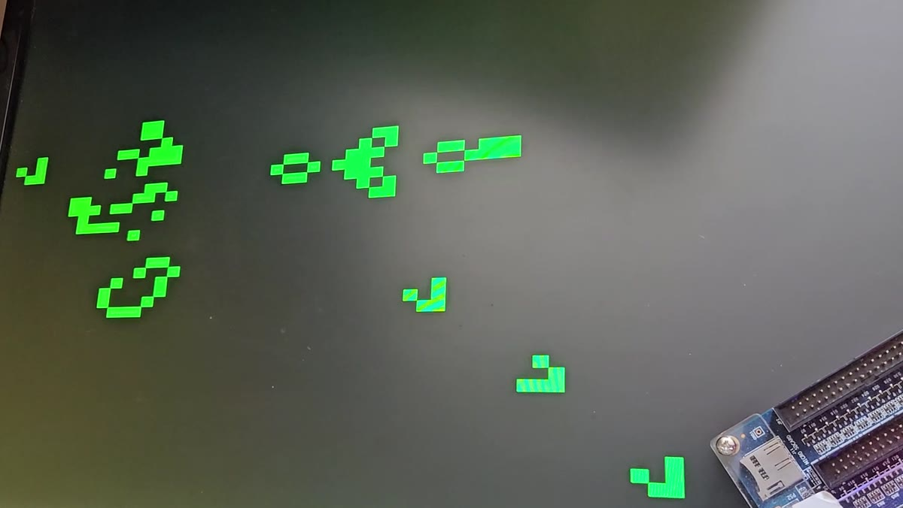

# Conway's Game of Life on an FPGA

*[Svensk version](README.sv.md)*

Conway's Game of Life in VHDL on a Terasic DE0-CV board (Cyclone V), drawn on a VGA monitor: an
80×60 grid of 8×8-pixel cells at 640×480, 60 Hz. My own project in the Digital Electronics course
(Digitalteknik) at Yrgo, Gothenburg, spring 2026.

[](https://edwardfalk.com/video/game-of-life.mp4)

*The Gosper glider gun running on the board. [Watch the 13 s clip →](https://edwardfalk.com/video/game-of-life.mp4)*

## Features

- 640×480 VGA at 60 Hz from a 25 MHz pixel clock, cells drawn green on black
- Eight preset patterns in ROM, picked with the switches: glider, blinker, R-pentomino, Gosper
  glider gun, LWSS, acorn, toad and diehard
- Pause, single-step, or run at 1 to 60 generations a second
- Edges that wrap around (toroidal) or that cells die at (finite)
- A generation counter on the 7-segment displays and the population as a logarithmic meter on the
  LEDs

## How it works

The grid is held in two 4800×1-bit block-RAM buffers, one M10K block each. The renderer shows one
buffer while `gol_engine` computes the next generation into the other, and the buffers swap when the
engine is done. The engine walks the grid cell by cell: it reads the eight neighbours and the cell
itself, one read per clock, counts the live neighbours and writes the cell's new state.

```
50 MHz ─► clk25_div ─► 25 MHz, clocks everything below

KEY[3:1] ─► debounce ×3 ─► control_fsm ─► pattern_loader ◄─ pattern_rom
                                │                │
                                ▼                ▼
                           gol_engine ◄────► grid_bram (two buffers, 2 × M10K)
                                                 │
                                                 ▼
                           vga_renderer (+ vga_timing) ─► VGA R/G/B/HS/VS
```

| Module | Job |
|---|---|
| `clk25_div` | Divides the 50 MHz board clock down to the 25 MHz pixel clock |
| `vga_timing` | 640×480 at 60 Hz sync pulses and pixel counters, inside `vga_renderer` |
| `vga_renderer` | Maps each pixel to its cell and picks the colour |
| `grid_bram` | The two grid buffers, written so Quartus infers block RAM |
| `gol_engine` | The next-generation state machine, edge mode and population count |
| `pattern_rom`, `pattern_loader` | The eight presets, copied into the grid on KEY[3] |
| `control_fsm` | Pause, step and run, with the speed divider |
| `debounce` | Two-flip-flop synchroniser, 20 ms debounce and a press pulse per key |
| `hex_decoder` | 7-segment digits |
| `top` | Wiring, the LED meter and the displays |

## Controls

| Control | Function |
|---|---|
| `SW[2:0]` | Start pattern (0–7) |
| `SW[5:3]` | Speed: 0 = 1 generation a second, 7 = 60 |
| `SW[9]` | Edges: down = wrap around, up = finite |
| `KEY[3]` | Load the selected pattern and pause |
| `KEY[2]` | Pause / run |
| `KEY[1]` | Step one generation (while paused) |
| `KEY[0]` | Unused |
| `HEX0-3` | Generation counter (0–9999, wraps) |
| `HEX4` | "P" while paused |
| `HEX5` | Always dark (see hardware notes) |
| `LEDR[9:0]` | Population, logarithmic: 2, 4, 8 … 1024 cells |

## Patterns

| `SW[2:0]` | Pattern | Behaviour |
|---|---|---|
| 0 | Glider | Travels diagonally forever |
| 1 | Blinker | Oscillates with period 2 |
| 2 | R-pentomino | Methuselah, chaotic for about 1100 generations |
| 3 | Gosper glider gun | Fires a new glider every 30 generations |
| 4 | LWSS | Lightweight spaceship |
| 5 | Acorn | Methuselah, grows to 633 cells over about 5206 generations |
| 6 | Toad | Oscillates with period 2 |
| 7 | Diehard | Dies out after exactly 130 generations |

## Simulation

The core modules have GHDL testbenches, ten of them in `tb/`:

```bash
make tb_<module>    # run one testbench, e.g. make tb_gol_engine_glider
make wave_<module>  # open its VCD in GTKWave
make clean
```

## Building

Quartus Prime Lite 25.1, device 5CEBA4F23C7. The pin assignments in `gol.qsf` follow Terasic's
DE0-CV golden-top reference.

```bash
quartus_sh --flow compile gol
quartus_pgm -m jtag -o "p;output_files/gol.sof"   # board's RUN/PROG switch in RUN
```

Resource use: 805 of 18,480 ALMs (4 %), 317 registers, 2 of 308 M10K blocks and 81 pins.

## Two bugs worth knowing about

- **169 % of the chip.** The first `grid_bram` chose between its two buffers inside the RAM
  processes, so Quartus couldn't infer block RAM and built the grid from logic instead:
  31,268 ALMs, 169 % of the device. Splitting it into two separate RAM entities, with the buffer
  select outside them, brought it down to 188 ALMs and 2 M10K blocks.
- **Off by one read.** The engine assumed a block-RAM read answers on the next clock, but in this
  design the data arrives two clocks after the address is set. Every neighbour landed one slot off.
  The blinker testbench still passed, because the blinker is symmetric and the errors cancelled out,
  but gliders drifted sideways one cell per generation instead of moving diagonally. The fix came
  with a glider testbench that uses the real `grid_bram`.

## Hardware notes

The DE0-CV this was built on has two dead segments (d and e) on HEX5, so the design leaves HEX5
dark. On a healthy board, HEX5 is free for more information.

## Credits

Written together with [Claude Code](https://claude.com/claude-code) as a pair programmer: most
commits carry a `Co-Authored-By: Claude` line.
